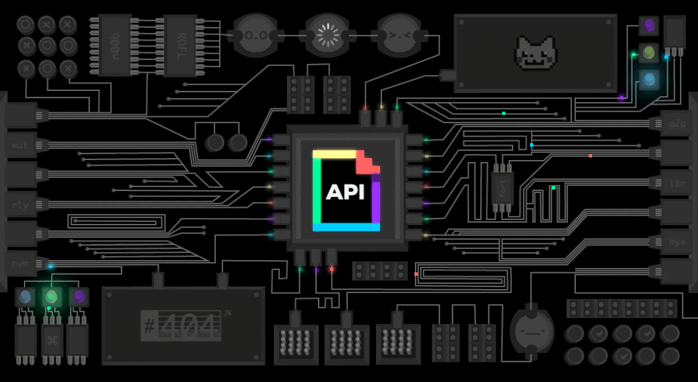

<!--

-->

<!--

-->

<!---->

<!---->

---

### ☕️ Networking
기술 직군의 기술적인 교류, 커리어 이야기, 직군 무관 네트워킹 모두 환영합니다!

위클리 아카데미 오픈 채팅방(비밀번호: 9323)

- kakaotalk: [https://open.kakao.com/o/gyvuT5Yd](https://open.kakao.com/o/gyvuT5Yd)

---

### 💁🏻‍♂️ Brief
- I'm 테오, Theo
- Working as a **Chief Technical Officer**
- Mainly using **Kotlin**, Java
- Have studied programming for 20 years+ since 2003. During that time, I developed many programs and had many opportunities to improve my skills dramatically.

### 💼 Experience
- **Bolta** - Chief Technical Officer & Co-Founder
- **Code for Korea** - Maintainer & Organizer
- **KSUG(Korea Spring User Group)** - Organizer
- **PyCon Korea** - Organizer
- **kakaopay** - Software Engineer
- **Hackle** - Software Engineer
- **Codestates** - Simulated Technical Interviewer and Mentor
- **Ministry of Science and Technology, Republic of Korea** - Consultant
- **Ministry of Health and Welfare, Republic of Korea** - Consultant
- **Ministry of the Interior and Safety, Republic of Korea** - Advisor, Mentor and Consultant
- .. And more

### :octocat: Contributions
- https://github.com/mongodb/mongo-java-driver/pull/996
- https://github.com/mongodb/mongo-java-driver/pull/997
- [mongodb/mongo-java-driver#4719](https://jira.mongodb.org/browse/JAVA-4719)
- https://github.com/mongodb/mongo-java-driver/pull/999
- [OpenFeign/feign#2458](https://github.com/OpenFeign/feign/issues/2458)
- [OpenFeign/feign#2459](https://github.com/OpenFeign/feign/pull/2459)
- https://github.com/google/ksp/pull/1088
- https://github.com/line/kotlin-jdsl/pull/68
- https://github.com/JetBrains/Exposed/pull/1582
- https://github.com/postmanlabs/postman-app-support/issues/10221

### 📄 Contents - Individual
- [결과에 확신이 없더라도 꾸준히 노력해야 하는 이유](https://dataportal.kr/결과에-확신이-없더라도-꾸준히-노력해야-하는-이유/)
- [[Java & Kotlin] enum class가 완벽한 싱글톤이라 불리는 이유](https://jinssssun.tistory.com/54)
- [Why DDD, Clean Architecture and Hexagonal ?](https://dataportal.kr/Why-DDD-Clean-Architecture-and-Hexagonal/)
- [Facebook을 다운 시킨 원인, BGP hijacking이 무엇인가?](https://jinssssun.tistory.com/14)
- [상황 학습을 실현할 수 있는 조직을 만들자](https://jinssssun.tistory.com/31)
- [좋은 동료는 어떤 동료일까? (feat. 띵스플로우)](https://jinssssun.tistory.com/30)
- [Webhooks(웹훅) 시스템 체크리스트](https://dataportal.kr/Webhooks(%EC%9B%B9%ED%9B%85)-%EC%8B%9C%EC%8A%A4%ED%85%9C-%EC%B2%B4%ED%81%AC%EB%A6%AC%EC%8A%A4%ED%8A%B8/)
- [내가 개발 커뮤니티를 하는 이유 (a.k.a 10년 회고)](https://jinssssun.tistory.com/89)
- [Java Compiler Optimization](https://dataportal.kr/Java-Compiler-Optimization/)

### 📜 Contents - Collective
- [[kakaopay] 오픈소스 활동 이야기](https://tech.kakaopay.com/post/junior-opensource)
- [[Code for Korea]Civic Hacking for COVID-19 Recovery: The Story of Code for Korea](https://codeforall.org/2022/09/06/civic-hacking-for-covid-19-recovery-the-story-of-code-for-korea)
